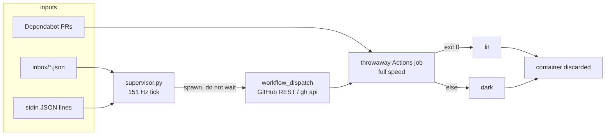

# tick-sandbox

A slow supervisor loop that ticks at **151 Hz**, checks a queue for new inputs every tick, and for each input spawns a fresh full-speed throwaway [GitHub Actions](https://docs.github.com/en/actions) job. The supervisor continues listening immediately — it never waits for a job to finish.

Each job runs the program in its own runner container, reports **lit** (success) or **dark** (anything else), and the container is discarded.

Dependabot is a second input source: weekly updates for `github-actions` and `pip`, plus a workflow that runs the same throwaway job pattern on Dependabot pull requests.

## Concept



- **Supervisor rate:** 151 ticks per second → at most **151 bits/steps per second** of queue intake.
- **Jobs:** run at full runner speed; lit/dark is decided inside the throwaway container.
- Vocabulary: outcomes are **lit** or **dark** only.

## Layout

| Path | Role |
|------|------|
| `supervisor.py` | 151 Hz loop, inbox/stdin queue, dispatch |
| `inbox/` | Drop JSON job files here (`job_id`, `command`) |
| `.github/workflows/job.yml` | `workflow_dispatch` throwaway job |
| `.github/workflows/dependabot-job.yml` | Same job pattern for Dependabot PRs |
| `.github/workflows/ci.yml` | Runs tests; must stay lit |
| `.github/dependabot.yml` | Weekly github-actions + pip |

## Job file format

```json
{
  "job_id": "hello-1",
  "command": "echo hello && true"
}
```

Place files as `inbox/*.json`. After dispatch they move to `inbox/processed/`.

## How to run

### Dry-run (local subprocesses, no Actions)

```bash
# one-shot demo: drop a job, tick a few times
mkdir -p inbox
printf '%s\n' '{"job_id":"demo","command":"true"}' > inbox/demo.json
python3 supervisor.py --dry-run --max-ticks 20
```

### Live dispatch (needs auth)

Uses `GITHUB_TOKEN` / `GH_TOKEN`, or falls back to `gh api` (never prints secrets).

```bash
export GITHUB_REPOSITORY=fitzyracing1/tick-sandbox
# or: gh auth login   # already done on this box as fitzyracing1
printf '%s\n' '{"job_id":"live-1","command":"true"}' > inbox/live-1.json
python3 supervisor.py --max-ticks 20
```

Watch the run under Actions; the step summary shows **lit** or **dark**.

### Manual workflow_dispatch

```bash
gh workflow run job.yml -f job_id=manual-1 -f command='true'
gh run list --workflow=job.yml --limit 3
```

### Tests / CI

```bash
pip install -r requirements-dev.txt
python -m pytest -q
```

CI on `main` must end **lit**.

## Limits

| Layer | Limit |
|-------|--------|
| Supervisor | 151 Hz → 151 bits/steps per second of intake |
| Jobs | Full runner speed; one throwaway container each |
| Waiting | Supervisor never blocks on job completion |
| Dependabot | Weekly; PR workflow runs the same lit/dark job |

## License

MIT — Copyright (c) 2026 Joshua Almeida
